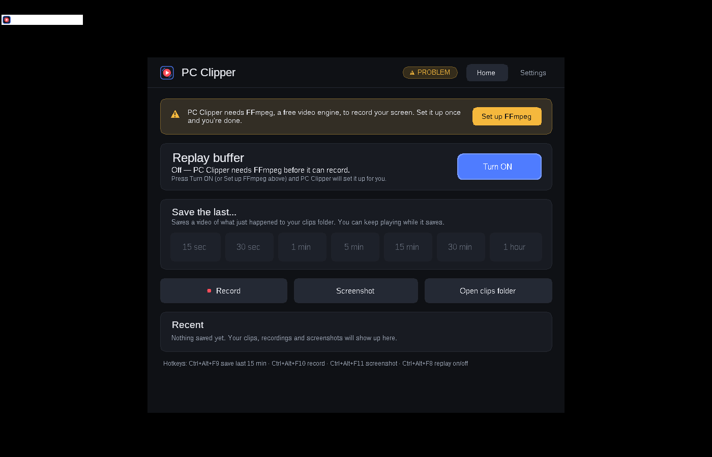

# PC Clipper

Save the last few minutes of your gameplay with one button, like the PlayStation "save recent gameplay" feature.

**[⬇ Download PC Clipper 1.0.1 for Windows (73 MB)](https://github.com/akaa647382-spec/Pc-clipper/raw/main/download/PC-Clipper-1.0.1-win-x64.zip)**
— Windows 10/11, 64-bit. SHA-256 `54b2bd313e06201a14fdb19ce1d732ea5d16dd7c84e9886478749b909b53e7b2`

- **Replay buffer**: turn it on and PC Clipper quietly keeps the last **1 to 60 minutes** of your screen and sound.
  Nothing is saved until you ask.
- **Save the last…** 15 sec, 30 sec, 1 min, 5 min, 15 min, 30 min or 1 hour, from the window, the tray icon, or a hotkey.
  Saving copies what's already recorded (no re-encoding), so it's quick and barely touches your game;
  an hour of high-quality video still takes a little while because it's tens of gigabytes.
- **Record**: normal start/stop recording, as long as you like.
- **Screenshot**: a full-quality PNG of your screen.
- **Quality**: up to 5K (5120×2880) at 120 fps, using your graphics card's video encoder (NVIDIA, AMD or Intel).

## Install

1. Unzip the download, put the `PC Clipper` folder anywhere (for example your Desktop) and double-click `PC Clipper.exe`.
2. Windows may show a blue box "Windows protected your PC". That happens with any new app that isn't signed by a company;
   it doesn't mean a virus was found. Click **More info → Run anyway**.
   (If your PC has *Smart App Control* turned on, Windows won't offer that button.)
3. On first start PC Clipper asks to download **FFmpeg**, a free video engine (about 110 MB, version 8.1).
   Click **Download**. The file's fingerprint (SHA-256) is checked before it is used.
   If you already have FFmpeg 8.1 or newer, click **I have it – browse…** instead.

## Use

| What | Default hotkey |
|---|---|
| Save the last 15 minutes (change the length in Settings) | **Ctrl+Alt+F9** |
| Start / stop recording | **Ctrl+Alt+F10** |
| Screenshot | **Ctrl+Alt+F11** |
| Turn the replay buffer on / off | **Ctrl+Alt+F8** |

Clips and recordings go to `Videos\PC Clipper`, screenshots to `Pictures\PC Clipper`. A small notice appears in the corner
when something is saved (on Windows 10 version 2004 and newer it is hidden from your clips). Every hotkey can be changed in Settings.

### Controller

Xbox and PlayStation controllers (DualShock 4, DualSense, DualSense Edge) work too, over USB or Bluetooth, while you play:
hold the first button and press the second.

| What | Xbox | PlayStation |
|---|---|---|
| Save the last 15 minutes | **View** + **A** | **Create** (PS5) / **Share** (PS4) + **Cross** |
| Start / stop recording | **View** + **X** | **Create/Share** + **Square** |
| Screenshot | **View** + **Y** | **Create/Share** + **Triangle** |
| Turn the replay buffer on / off | not set (pick a combo in Settings) | not set |

When you connect a controller, PC Clipper recognises it and says so ("PS5 controller connected - Create/Share + Cross
saves the last 15 min"); the Home page then lists its shortcuts in that controller's button names. An Xbox controller
rumbles briefly when a shortcut worked. **Settings → Controller** shows the connected controllers, lets you pick other
combos (or turn them off) and has a button tester. If a game uses one of these combos itself, pick another one there.
PlayStation controllers used through **Steam** or **DS4Windows** may show up as Xbox controllers (and use the Xbox
button names) - that works too. If you use DS4Windows, hide the controller with **HidHide** (and add PC Clipper to
HidHide's allowed apps, or leave it out and PC Clipper uses DS4Windows' virtual Xbox controller). DS4Windows' old
*Hide DS4 Controller* (exclusive) option can't work while PC Clipper or Steam has the controller open: games would then
see the controller twice. The **Xbox / PS button** isn't offered for shortcuts, because Xbox Game Bar and Steam react to
it and take the focus from your game; a combo with it saved by an earlier version still works and is marked in Settings.

## Good to know

- **Disk space**: the buffer lives on your disk, not in memory. Settings shows how much it needs, e.g. about 17 GB for
  60 minutes at 1440p 60 fps on High. If your main drive is small or you want to spare your SSD, move the buffer folder to
  another drive in Settings. Saving a clip needs that much free space again for the file.
- **5K / 120 fps**: only worth it if your monitor really is 5K / 120 Hz; PC Clipper can't add detail that isn't on your screen,
  and it never records faster than your monitor refreshes. 5K needs HEVC or AV1 and a strong graphics card (RTX 40/50 class).
  Use **Settings → Test my PC** to see what your PC really manages before relying on it.
- **120 fps capture**: Windows' standard capture (Desktop Duplication) may only catch about 60 different frames per second.
  Test my PC measures it; *Capture method → Windows Graphics Capture* avoids the limit (best on Windows 11). It only
  records while something on screen changes, and Windows 10 draws a yellow border while it runs, so it is never chosen
  automatically.
- **Interruptions**: a UAC prompt, the lock screen, or a game switching resolution/fullscreen briefly stops screen capture.
  PC Clipper resumes by itself and keeps what it had already buffered.
- **Changing quality settings** restarts the buffer, so what was buffered before is cleared. Changing only the buffer
  length doesn't: it applies right away and keeps what is buffered.
- **Closing or shutting down while a clip or recording is being saved**: PC Clipper finishes writing it first (Windows
  shows "PC Clipper is preventing shutdown – Saving your clip…" meanwhile).
- **A recording couldn't be saved** (drive full, folder blocked)? PC Clipper keeps it: free up space or pick another
  clips folder, then press **Try again** on the Home page.
- **Crash or power cut during a recording?** The next time PC Clipper starts, it saves what was recorded up to that point
  as `Recording … (recovered).mp4`.
- **HDR**: if Windows HDR is on, clips look washed out. Turn HDR off while recording for accurate colours.
- **Some games block app hotkeys** while they are in front. Use a controller shortcut or the tray icon's menu in those.
- **Sound out of sync?** Settings → Audio → *Sound sync* shifts the sound earlier or later.
- **Something wrong?** Settings → *Open log folder* and send `pcclipper.log`.

## For developers

Built on Linux with the .NET 8 SDK: `./build.sh` (add `test` to run the engine harness against real ffmpeg).
How it works, and why each FFmpeg flag is there: [SPEC.md](SPEC.md) and the research notes in [docs/research](docs/research).
