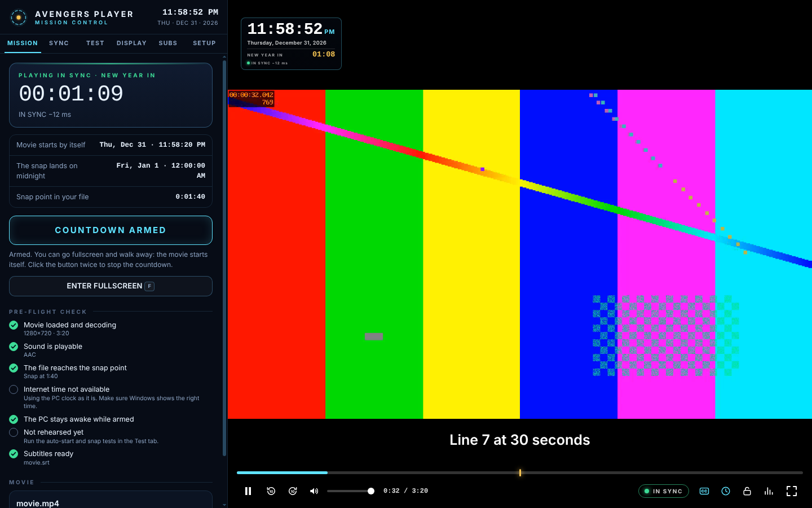

# Avengers Player

A Windows video player that starts *Avengers: Endgame* by itself on December 31, keeps the film locked to the clock
for the whole two and a half hours, and lands the snap on **12:00:00 AM**: the very frame on which his fingers snap,
found in your own file and put on midnight to the millisecond. It works with *Avengers: Endgame* (3:01:11) and with
*Avengers Endgame: Encore* (3:01:36).

**[Download the installer](../download/Avengers-Player-Setup-1.2.0.exe)** (Windows 10 / 11, 64-bit, about 93 MB).
You bring your own copy of the movie. Nothing is uploaded anywhere.



## Install

1. Run `Avengers-Player-Setup-1.2.0.exe`. It installs for your user only, so there is no administrator prompt.
2. Windows may show a blue box, "Windows protected your PC". That appears for any new app that is not signed by a
   company. Click **More info → Run anyway**. (If *Smart App Control* is switched on, Windows offers no such button.)
3. Start **Avengers Player** from the desktop or the Start menu.

## On the night

1. **Import the movie.** Drop the file on the window or click to browse. The app finds the snap in it (see below).
2. Click **START THE COUNTDOWN**. You can do this days ahead: the movie waits for December 31.
3. Press **F** for fullscreen. A standby screen counts down to the start.
4. Walk away. The movie starts by itself at the time shown in the Mission tab: a second or two before 9:29:30 PM,
   exactly as early as the snap in your copy needs.

**If the app crashes, it comes back by itself.** While the countdown is armed a small watchdog keeps an eye on the
app. If the app crashes or is killed, the watchdog starts it again within a couple of seconds; after a restart of the PC,
Windows opens it again when you sign in. Either way it imports the movie again and jumps to exactly where the clock says
the film should be. Nothing to click. (Closing the app yourself is different: it asks first, and then stays closed.)

## Rehearse first (Test tab)

A test run moves the app's own clock, not your PC clock, so you can try the whole thing today.

| Test | What it proves |
|---|---|
| **Auto-start** | Jumps to a few seconds before 9:29:30 PM. The movie must start alone, on the dot. |
| **Snap** | Jumps to just before midnight. Watch the snap land on 12:00:00, the date roll over to January 1 and the animation play. |
| **Slip and recovery drill** | Knocks the film out of sync on purpose so you can practise **Recalibrate**. |
| **Crash recovery** | With the countdown armed, press *Crash the app now*. The app crashes for real and is back, in sync, a few seconds later. |

Each test prints a result with the measured error in milliseconds.

## The snap is found for you

"Start at 9:29:30 PM" puts the snap at 2:30:30, and that is a round number. In the film the fingers snap a moment
later, and how much later differs from copy to copy: a Blu-ray copy, a streaming copy and the 2026 Encore cut are
all timed differently. So the app takes nothing from a table. **When you import a movie, it finds the snap in that
file by itself and sets the countdown by it.**

1. Import the movie. After a moment a box says *Finding the snap in this film*: the app plays that part of the film
   without sound and looks at every frame. It takes ten seconds or so, once per file.
2. A **film strip** opens: one small picture per frame, with the film itself paused on the chosen frame above it.
   The title reads *Snap found: 2:30:31.5…* and the start time of the movie has already moved with it.
3. Look at the picture. If it is the frame where his fingers snap, press **Yes** (or just close the strip). If it is
   a frame off, step with **←** **→** and press **Put the snap on this frame**.
4. Run the **Snap test** when you like. Afterwards the strip shows the frame the app put on 12:00:00 and how many
   milliseconds from the clock it came on screen.

The app has two witnesses. One is the picture: the flash that fills the screen when the fingers snap. The other is
the subtitles, either a file you loaded or the subtitles inside the movie itself (FFmpeg reads them): the snap comes
a moment after the line *"And I… am… Iron Man."* goes off screen, in every cut.

| What the app found | What it does |
|---|---|
| The flash, right after the line (or a clear flash and no subtitles to ask) | Sets the snap point on that frame and shows it |
| The line, but no flash in the picture | Sets an estimate just after the line, says that it is an estimate, and asks you to pick the frame |
| A flash that is not where the line says | Changes nothing, warns you, and lets you pick |
| Nothing | Changes nothing and shows you the frames around 2:30:30 |

If the snap is nowhere near 2:30:30 in a copy, the app goes to the line, or sweeps a wider stretch (45 s before to
105 s after). Every film file remembers its own snap point, so any number of copies can be set once and then swapped
freely. Starting the countdown with a snap point that was never checked asks first. **FIND THE SNAP** (Mission tab,
or Setup → Snap point) runs the search again at any time, and the frame buttons in Setup still work by hand.

## Which version of the film?

The app tells the two cuts apart by the length of the file (**Setup → Film version** shows it and lets you change it).

| Cut | Length | Snap point |
|---|---|---|
| *Avengers: Endgame* (2019) | 3:01:11 | a moment after 2:30:30; found in the file |
| *Avengers Endgame: Encore* (2026) | 3:01:36 | found in the file; the search covers the extra 25 seconds |

For neither cut is the snap point taken from a table: it is found in the file when the file is imported, as
described above. Until a snap point has been found or picked, the pre-flight list keeps a line saying so.

What is known from outside the file. A published subtitle file made from the 4K Blu-ray's own subtitle track
shows *"Iron Man."* from 2:30:29.9 to 2:30:31.4, so on a Blu-ray copy the snap is at about 2:30:31.5, a second and a
half after the round figure. The same lines sit about 1.5 s earlier in subtitles of the iTunes version, which fits
the figure everybody quotes, 9:29:30 PM
([Looper](https://www.looper.com/1475223/avengers-thanos-iron-man-snaps-marvel-timestamps-start-new-year)), having
been worked out on a streaming service
([Laughing Place](https://www.laughingplace.com/w/articles/2021/12/31/ring-in-the-new-year-by-timing-up-these-5-mcu-moments-to-the-stroke-of-midnight/)).
These are subtitle timings, good to a few tenths of a second, not frame counts: which is why the app looks at the
picture. For Encore, a scene-by-scene guide puts
the first new scene at 2:48:50
([CinemaBlend](https://www.cinemablend.com/movies/i-grabbed-avengers-endgame-encore-doomsday-scene-timestamps)), after
the snap. Other lengths than 3:01:36 have been published for Encore; a file longer than 3:01:24 is treated as Encore
whatever its exact length.

## If you are late

Nothing has to be armed in advance for the night to work. If the app is opened, or the movie imported, after the
movie should have started (even at 11:59 PM), or the PC crashed with no countdown armed, a box says so:

> **You are late to the countdown** · The movie had to start at 9:29:28 PM. Right now it should be at 1:12:43. · **JOIN NOW**

Press the button, **Enter**, **Space** or the play button: the film jumps to where the clock says it should be and
stays locked to it, exactly as if the countdown had been armed all along. *Not now* puts the box away and leaves a
small reminder at the top. In the ten minutes before the start, a player that is not armed shows a reminder too.

## If someone slips

While the countdown is armed, a pause or a click on the timeline does not ruin the night. A small box appears in the
middle of the screen (in fullscreen too):

> **You slipped** · The movie is 12.4 s behind the clock · **RECALIBRATE**

Click it, or press **R**, **Enter** or **Space**. The film jumps back to where the clock says it should be. If nobody
reacts, it recalibrates by itself after 10 seconds (changeable in Setup). Stalls, a sleeping PC and decoder hiccups are
corrected automatically, without a box. If a stretch of the file is damaged, playback resumes by itself as soon as the
clock is past it. **L** locks the controls so a slip cannot happen at all.

## On-screen clock

Top left of the picture: the **digital clock**, the **date** under it, and the **countdown** under that. For the last ten
seconds the countdown grows inside that panel and ticks 10, 9, 8 … Nothing is drawn across the picture. At midnight the
date rolls over from December 31 to January 1.

| Key | |
|---|---|
| **O** | Show or hide the whole overlay (hide it if everyone has a phone out anyway) |
| **N** | Countdown mode on or off |
| **T** | The 10 · 9 · 8 animation in the clock panel for the last ten seconds, on or off |
| **H** | Happy New Year animation: Stark (gold dust forms the words, then blows away), Fireworks, Minimal, Off |
| **A** | Sound language: switches between the sound tracks of the movie |
| **C** | Subtitles on or off |
| **Z** / **X** | Subtitles earlier / later |
| **←** **→** / **Enter** / **Esc** | In the film strip: step a frame, set the snap on the frame, close |
| **F** / **F11** | Fullscreen |
| **R** | Recalibrate |
| **L** | Lock the controls |
| **Space**, **←** **→**, **↑** **↓**, **M** | Play/pause, skip 10 s, volume, mute |

Position, size, 12/24-hour clock, six app themes and which side the control panel sits on are in the **Display** tab.

## Subtitles

**Subs → Load subtitle file** takes `.srt`, `.vtt`, `.ass` and `.ssa`. A subtitle file with the same name as the movie,
in the same folder, is loaded by itself. If the letters look wrong (older Arabic, Cyrillic, Greek, … files), pick the
language under *Text encoding*. Size, colour, outline or box, height and timing are adjustable.

## What "in sync" means here

The film position is always computed from the clock: *position = now − start time*. The player measures, frame by
frame, how far the picture is from where it should be. A few milliseconds are corrected by nudging the speed by a
fraction of a percent; anything bigger is corrected by re-cueing the film to the exact frame and pressing play at the
exact instant. The **Sync** tab shows the live error and a graph.

The clock itself is checked against internet time servers (NTP), because a PC clock can be seconds off. If your PC
is 0.8 s slow, the app corrects for it and says so. Offline, it uses the PC clock as it is.

## Files and sound

Video is played by Chromium at its native resolution, untouched: H.264 always, HEVC (H.265) when the graphics card
supports it. **Dolby (AC-3 / E-AC-3) and DTS sound cannot be decoded.** The player notices this when you import the
file (on a PC without FFmpeg it plays the first two seconds silently to find out) and offers **Fix the sound**: the
picture is copied bit for bit and only the sound is converted to AAC. That needs FFmpeg; the app finds the copy
PC Clipper downloaded, or downloads it once (about 100 MB).

**English plays by itself.** Many copies of the film carry several sound tracks, for instance a Hindi dub first and
the English original second, with the dub flagged as the main track. The player ignores that flag: it plays the
English track, and *Fix the sound* converts the English track. The fix dialog lists the languages in the file, with
English preselected, and by default keeps the other languages in the new file so you can still switch. To switch, use
**Sound language** in the Mission tab, the language button on the control bar, or press **A**; a choice made by hand
is remembered for that movie. Another default language can be set under **Setup → Sound language**. Subtitle tracks
inside the movie are carried over by the fix, so they can still be picked in the Subs tab.

If a file has no English sound at all (for example a copy that version 1.0.0 converted from a dubbed track), the
pre-flight list says *The sound is Hindi, not English*. Import the original movie file again and fix its sound: the
new copy is in English.

**Start the Countdown** checks for the mistakes that would only show at midnight: it refuses a file that ends before
the snap point, asks before arming a movie with no playable sound or with sound in another language than the one you
want, and switches the sound back on if the player was left muted.

## The day before

- Run the Auto-start and Snap tests with the real movie file. The pre-flight list in the Mission tab should be green.
- Plug the laptop in and leave the lid open. While armed the app stops the PC from falling asleep by itself, but
  closing the lid or pressing the power button still puts it to sleep, and a battery still runs out.
- Leave Windows Update alone until January 1.
- Start the countdown early in the evening and leave the app open.

## Honest limits

- The app is developed and tested on Linux with the same code (unit tests plus end-to-end tests that drive the real
  app), and the Windows installer and uninstaller are run under Wine. On a real Windows PC, version 1.0.0 is known to
  install, import a movie, convert its sound and play it; the timing figures come from the Linux test runs. Run the
  Auto-start and Snap tests on your own PC before you rely on it.
- Switching the sound language uses a part of Chromium that is still marked experimental. The app works around its
  one known weakness (it re-cues the film on every switch, and brings the sound back by itself if it ever stops), and
  the language is normally chosen once, before the countdown. Choose it during a rehearsal, not during the film.
- The app finds the snap by the flash that fills the screen when the fingers snap. That was tested on clips made
  for the purpose, not on the film itself, which the author does not have. So the frame it marks is a suggestion:
  look at the picture and move a frame or two if needed. If it finds no flash at all, the strip still opens and the
  frame is picked by eye.
- Around the snap the film is held to within about a hundredth of a second of the clock. On a 60 Hz screen a film
  frame can only come on screen at one of 60 moments a second, so a few milliseconds either way are the limit of
  any player; the strip shows the figure that was measured.
- The internet time check was tested against stand-in time servers only. If it cannot reach a real one on your PC, the
  pre-flight list says so and the app uses the PC clock as it is.
- Sound through Bluetooth speakers or a TV can lag behind the picture by a tenth of a second or more. That delay
  happens after the player and is not corrected.
- This is an unofficial fan project. It ships no film content.

## For developers

```
npm install
npm start                # run the app
npm test                 # unit tests + end-to-end tests (needs ffmpeg; uses xvfb on headless Linux)
npm run build:win        # package for Windows and build ../download/Avengers-Player-Setup-<version>.exe (needs makensis)
```

| Path | |
|---|---|
| `main/` | Electron main process: files, fullscreen, keep-awake, crash watchdog, NTP time, FFmpeg helper |
| `src/core.js` | Timing maths and the drift controller (pure, unit-tested) |
| `src/app.js` | The player: sync engine, slip recovery, test runs, overlay, panels |
| `src/subs-core.js` | Subtitle decoding and parsing |
| `src/fx.js` | The celebration animation |
| `tests/` | `unit/` (node:test), `e2e/` (Playwright driving Electron), `fx/` (animation frames) |
