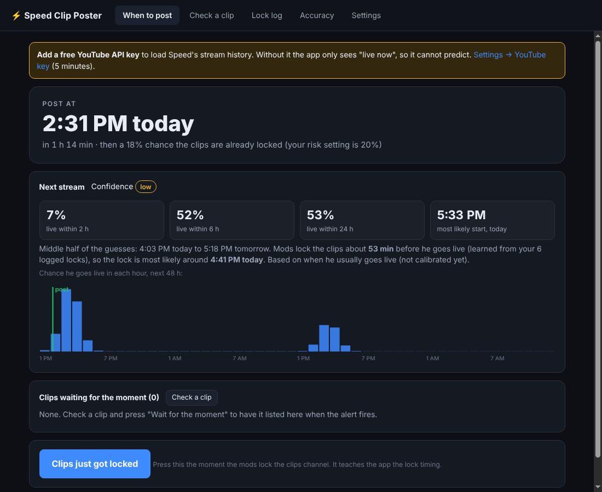

# Speed Clip Poster

A Windows app that tells you **when to post** your clip in the Speed Discord clips channel, so it sits near the
bottom (where Speed starts reading) instead of buried hundreds of clips up, and **whether the clip breaks the rules**
before you post it.

**[Download the installer](../download/Speed-Clip-Poster-Setup-1.0.0.exe)** (Windows 10 / 11, 64-bit, 97 MB).
SHA-256 `cfd593c5f61f2496ca3e6f76ceef12aa979b27c4607698dbcd43376de7eab03e`



It never logs in to Discord and never posts for you. You press post yourself, when it tells you to.
(Apps that post from your account are "self-bots": Discord bans accounts for them, and the server's rule 17 puts that on you.)

## What it does

**When to post.** It reads the exact start time of each of Speed's past streams from YouTube and learns when he usually
goes live (recent streams count more). It also learns how long before he goes live the mods lock the clips, from the
locks you log. From that it works out the latest moment you can post where the chance the clips are already locked is still
below your risk setting (20% by default). You get a desktop alert, and optionally a phone alert, 15 minutes before and
again at **POST NOW**.

- If YouTube shows a **scheduled stream**, that time wins and confidence is high.
- If a stream in the next 12 hours is unlikely, it says so and gives a rough time instead of making you post early,
  because a clip posted 20 hours early is buried.
- It checks YouTube every 5 minutes for "live now" and "scheduled".

**Check a clip.** Drop a video in and it says **POST**, **RISKY** or **DON'T POST** and why:

| Checked | How |
|---|---|
| Too big for Discord (10 MB without Nitro) | file size; **"Make a 10 MB copy"** button re-encodes it to fit |
| Won't play inside Discord (MKV, AVI, HEVC) | file and video format |
| Ads, @handles, links, "sub to me", cash tags | your message **and text on screen** (OCR on 6 frames) |
| Begging ("speed react", "notice me", "add me") | same |
| Slurs, NSFW words, war jokes, age jokes | same |
| You already posted it (even re-encoded or resized) | a picture fingerprint per second, compared with every clip you marked as posted |
| Unreactable: silent, black screen, slow start, ear-rape loud, too quiet, too long, blurry, choppy, still image | sound levels, black frames, scene cuts |

**Not checked**, and the app says so on every clip: words said out loud, nudity or gore in the picture, whether the clip
was stolen, whether it's AI-made, whether it's funny.

## How accurate is it?

The **Accuracy** tab replays the app on his own past streams. Starting after each stream ends, it re-checks every
30 minutes using only what it knew at that moment, and "you" post the first time it says POST NOW. It then reports:

- how often you'd have posted **before the lock and within 4 hours** of him going live (a good post),
- how often you'd have posted before the lock at all,
- too late / never said post,
- whether its percentages are honest ("when it said 60%, did he go live 60% of the time?").

It also **calibrates itself**: it tries different settings on his history and keeps whichever would have worked best.
That runs after the history loads and again each week.

On test data the numbers were:

| Made-up schedule | Good posts | Before the lock at all | Too late |
|---|---|---|---|
| Regular (around 8 PM, 5 days a week, skips some) | 93% (25 of 27) | 100% | 0 |
| Completely random times and breaks | 13% (2 of 15) | 73%, but mostly over a day early | 1 |

Speed's real schedule sits between those. Tours (World Cup, Caribbean) break any weekly pattern, and he often goes
live without scheduling. **The app hasn't been run on his real history yet** (YouTube was blocked where it was built),
so the Accuracy tab on your PC is the first real number. Treat it as the truth over anything in this README.

The lock timing is a guess (15–90 min) until you log 3 locks. **Press "Clips just got locked" every time you see it
happen.** That's the single biggest thing you can do for accuracy.

## Set up (10 minutes)

1. Install and start it. Windows may say "Windows protected your PC" because the app isn't signed by a company: **More info → Run anyway**.
2. **YouTube key** (free): Settings tab, follow the 4 steps. Without it the app only sees "live now", so it can't predict.
3. **FFmpeg**: Settings → Download (110 MB, fingerprint-checked). If PC Clipper or Avengers Player already downloaded it, it's found automatically.
4. **Phone alerts** (optional): install the free *ntfy* app, pick a long secret name, put the same name in Settings.
5. Leave it running. Closing the window keeps it in the tray so alerts still come. Right-click the tray icon to quit
   or to log a lock.

## Use

1. **Check a clip** → fix whatever it flags → **Wait for the moment**.
2. When the alert says **POST NOW**: open the clips channel, post, press **I posted it**. The app then remembers the clip,
   so it can warn you if you try to post it again (reposting can get you blacklisted).
3. When you see the mods lock the clips: **Clips just got locked**.

## For developers

```
npm install
npm start                        # run the app
npm run media && npm test        # unit tests (predictor, YouTube, rules, FFmpeg + OCR on real clips)
xvfb-run -a npm run test:e2e     # drives the real app through every tab
npm run build:win                # Windows installer into ../download (needs makensis)
```

- `core/predictor.cjs`: the stream-start model, lock timing, post time, backtest and calibration (pure functions).
- `core/youtube.cjs`: YouTube Data API v3 (uploads playlist + `liveStreamingDetails`), and a no-key fallback that reads
  the public /live page.
- `core/clipcheck.cjs`: the rules. `main/analyze.cjs`: FFmpeg facts, fingerprints, OCR (tesseract.js, English data
  bundled, nothing downloaded), the small copy.
- Data lives in `%APPDATA%\Speed Clip Poster\data.json`. The API key is encrypted with Windows' per-user encryption.
